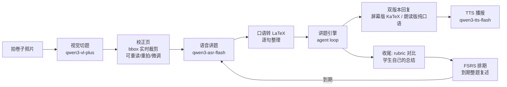

# tutor 讲伴

**语音优先的 AI 数学讲题产品**：拍一张卷子 → 自动切题 → 苏格拉底式语音讲题 → 按记忆曲线回来让你复述。

学生最痛的假象是"看答案看懂了，合上书不会做"。讲伴不直接给答案——它用追问引导学生把题**自己讲出来**，用耳朵听、用嘴回答，手不用离开笔；讲完一道题，按 FSRS 记忆曲线排好下次复述的时间，到期自动提醒你回来整题复述一遍。

## 它怎么工作



整条链路对**多个模型**做了编排：视觉切题、语音识别、口语公式化、苏格拉底讲题、语音合成各用不同的模型，讲题模型可在 DeepSeek / Qwen 之间随时切换。每轮回复生成**两个版本**：屏幕版允许 LaTeX（KaTeX 渲染），朗读版是纯口语专供 TTS——因为数学公式没法直接念。

## 讲题引擎：agent loop

核心设计是**规则优先于模型**：

- 每轮先由确定性策略状态机（`tutor_policy.py`）决策教学动作：追问 / 提示 / 讲解 / 验证……LLM 只是被调用的生成工具；
- 生成时注入该动作的**契约约束**（如"本轮恰好一个问句，不替学生说答案"），回复不合契约就把要求反馈给模型重试（≤2 次），仍不合格用策略层兜底话术——**任何情况下都有合契约的回复**；
- 决策状态按 session 持久化，刷新页面接着算；
- 规则优先、状态机决策，意味着复现和调试不靠"再问一次模型看看"。

## 工程上值得一提的

- **离线重放验证**：用 42+ 条真实 tutor 会话重放 agent loop（`tutor_replay.py`），输出契约一次通过率、动作分布、兜底率——只读本地数据，不调模型、不花钱，改完策略马上能验证；
- **依赖注入的生成层**：loop 的 generate 函数由外部注入（线上注入真实模型调用，测试/重放注入假函数），核心逻辑不碰 HTTP、不碰数据库、不调模型，可以完整单测；
- **会话落库**：每道题的每轮对话写入 SQLite，刷新、重启后回到同一题恢复对话；tutor / 复习模式分开；
- **跨页题合并**：选择题选项被分页拆开时（A/B 在第 1 页、C/D 在第 2 页顶部），管线用"顶部窄条二次识别"自动合并，跨页题存续块裁剪图留证；
- **细节修复都有提交记录**：回声误判改严（整段来自题目原文才拦）、ASR 防脑补、提示阶梯到顶回落等，见 commit history；
- **vendored py-fsrs**（MIT），复习调度不依赖联网安装。

## 快速开始

```powershell
# 双击运行，或：
cd tutor\server
python tutor_server.py
```

打开 <http://127.0.0.1:8793/>。本地服务，只监听 127.0.0.1。

配置（API key 等）与详细功能文档见 [docs/dev-log.md](docs/dev-log.md)。

## 技术栈

- 后端：Python（标准库 HTTP 服务，无框架依赖），SQLite
- 前端：原生 HTML / CSS / JS（无构建步骤）
- 模型：qwen3-vl-plus（视觉切题）、qwen3-asr-flash（语音识别）、DeepSeek / Qwen（讲题，可切换）、qwen3-tts-flash（语音合成）
- 复习调度：py-fsrs（vendored）

## 文档

- [docs/dev-log.md](docs/dev-log.md) — 完整功能与运维文档（原 README）
- [docs/three-rings.md](docs/three-rings.md) — 产品三环逻辑框架
- [docs/data-model.md](docs/data-model.md) — 数据模型
